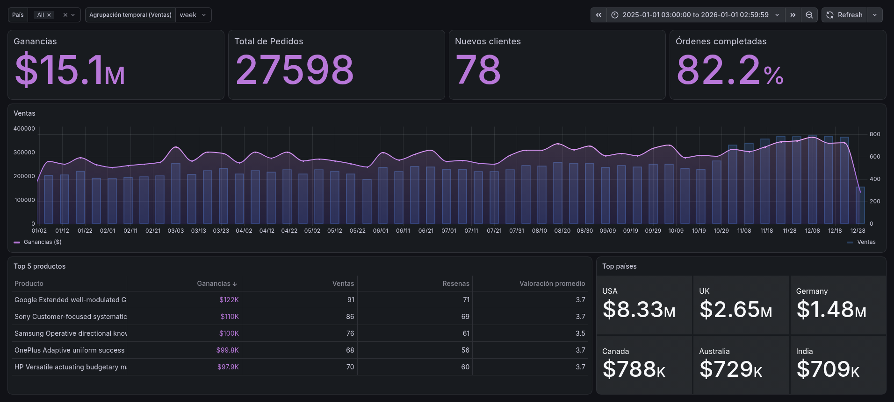

# 🛒 E-Commerce Sales & Customer Analytics Dashboard

## 🎯 Resumen del Proyecto
Este proyecto consiste en el desarrollo de un dashboard gerencial analítico e interactivo diseñado para evaluar el rendimiento de ventas, la salud financiera y el comportamiento de los clientes de una plataforma de comercio electrónico. El objetivo principal es proporcionar a los stakeholders una vista clara de los KPIs fundamentales, la evolución temporal de los ingresos y el rendimiento detallado de productos y mercados.

## 🛠️ Arquitectura y Stack Tecnológico
- **Base de Datos:** PostgreSQL alojada en [Neon.tech](https://neon.tech/) (Serverless Cloud DB).
- **Gestión y Modelado (ETL):** DBeaver (Ingesta de datos brutos y estructuración en un esquema relacional personalizado `ecommerce_shair_khan`).
- **Visualización:** Grafana Cloud (Conexión directa a PostgreSQL mediante consultas SQL nativas).
- **Fuente de Datos:** [E-Commerce Sales Analytics Dataset (Shair Khan - Kaggle)](https://www.kaggle.com/datasets/datascikhan/e-commerce-sales-and-customer-analytics).

## 📊 Insights y Lógica de Negocio
A partir de la exploración y modelado de los datos en el tablero, se identificaron los siguientes patrones clave de negocio:

- **Sostenibilidad por Recurrencia:** Se registró un volumen total de 27,598 pedidos generando $15.1M en ganancias y una tasa de cumplimiento de órdenes del 82.2%. La base de transacciones está impulsada principalmente por clientes recurrentes, con 78 clientes nuevos en el período, lo que señala una fuerte retención de marca pero sugiere oportunidades para reforzar campañas de adquisición.
- **Concentración de Mercado Regional:** Estados Unidos domina de forma absoluta la facturación global con $8.33M, seguido por Reino Unido ($2.65M) y Alemania ($1.48M). Canadá, Australia e India completan los mercados secundarios con ingresos sostenidos superiores a los $700K cada uno.
- **Rendimiento de Catálogo:** El Top 5 de productos demuestra que la recaudación no depende únicamente del volumen bruto de ventas, requiriendo un análisis cruzado entre volumen, satisfacción del cliente (valoración promedio de 3.5 a 3.7) y número de reseñas.

## 🧠 Desafíos Técnicos Resueltos
Para construir este tablero en Grafana utilizando PostgreSQL, se implementaron las siguientes soluciones analíticas:

- **Agrupación Temporal Dinámica (Variables Custom SQL):** Implementación de una variable personalizada (`rango_tiempo`) integrada con `DATE_TRUNC` y casteos de tipo (`order_date::timestamp`), permitiendo al usuario cambiar dinámicamente la granularidad del gráfico de series de tiempo entre día, semana y mes desde la barra de controles superior.
- **Visualización de Doble Eje Y (Dual Axis):** Configuración de un gráfico híbrido para comparar variables continuas (Ganancias en línea morada, eje izquierdo) frente a variables discretas (Volumen de ventas en barras azuladas, eje derecho), optimizando la escala visual y reduciendo el ruido cognitivo.
- **Limpieza y Formateo de Texto:** Uso de la función `LEFT` en PostgreSQL para truncar títulos extensos de productos en la tabla, manteniendo un diseño limpio sin desbordamiento de texto.
- **Línea Base Global (Paneles de Contexto):** Mantenimiento de paneles estáticos (Top Países) independientes de ciertos filtros para servir como punto de comparación constante frente al desempeño global.

## 📸 Vista Previa del Dashboard

## 🚀 Cómo replicar este proyecto
1. Descarga los archivos CSV del dataset original desde Kaggle.
2. Crea una instancia de PostgreSQL en Neon.tech e importa las tablas mediante DBeaver al esquema `ecommerce_shair_khan`.
3. Conecta Grafana Cloud a tu base de datos de Neon.tech usando las credenciales correspondientes.
4. Ejecuta las consultas guardadas en la carpeta `/sql` de este repositorio para recrear los paneles visuales (Time series, Stat, Table).
